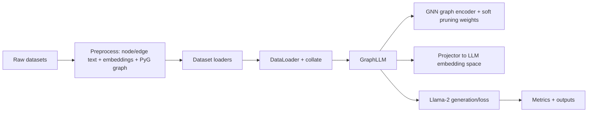
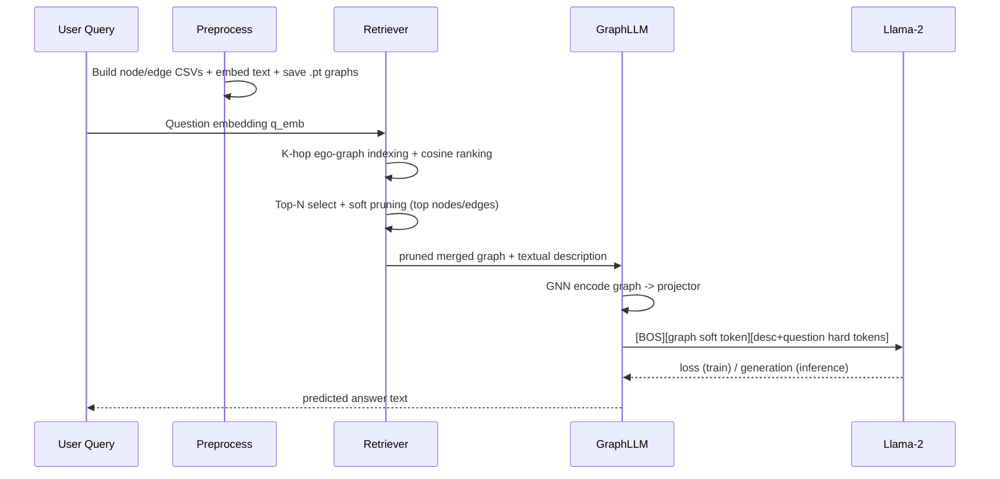
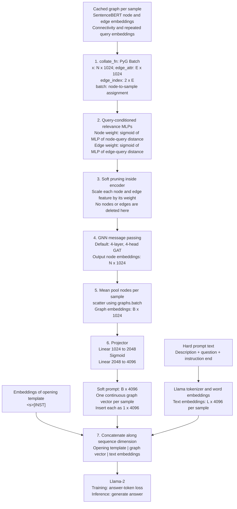

# GRAG Codebase Guide (Paper ↔ Implementation)

This guide explains how the **GRAG** paper maps to the code in this repository, with explicit references to source files and line numbers.

> Paper analyzed: `GRAG: Graph Retrieval-Augmented Generation` (NAACL 2025) from `/Users/I779981/Uni_Projects/Paper/GraphRAG.pdf` (text extracted to session file for inspection).

---

## 0) Quick reality check: paper vs repository

| Topic | Paper describes | Repository actually implements |
|---|---|---|
| Core idea | Retrieve relevant **textual subgraphs** + use graph/text dual view | Yes, implemented via retrieval + `GraphLLM` ([src/utils/graph_retrieval.py:223](src/utils/graph_retrieval.py#L223), [src/model/graph_llm.py:20](src/model/graph_llm.py#L20)) |
| Hierarchical hard prompt from BFS tree | Central in Section 4.2 / Appendix A.1 | Function exists (`hard_prompt`) but is not used in the active retrieval pipeline; code currently uses CSV-like node/edge text ([src/utils/text_graph.py:36](src/utils/text_graph.py#L36), [src/utils/graph_retrieval.py:208](src/utils/graph_retrieval.py#L208), [src/utils/graph_retrieval.py:211](src/utils/graph_retrieval.py#L211)) |
| Datasets in experiments | WebQSP + ExplaGraphs | Yes ([src/dataset/webqsp.py:23](src/dataset/webqsp.py#L23), [src/dataset/expla_graphs.py:8](src/dataset/expla_graphs.py#L8)) |
| Llama-2 backbone, optional LoRA | Yes | Yes ([src/model/graph_llm.py:42](src/model/graph_llm.py#L42), [src/model/graph_llm.py:54](src/model/graph_llm.py#L54), [src/model/graph_llm.py:63](src/model/graph_llm.py#L63)) |

---

## 1) Project architecture

### Repository structure

- Training/inference entry points: [train.py](train.py), [inference.py](inference.py)
- Models: [src/model/](src/model)
  - LLM-only baseline: [src/model/llm.py](src/model/llm.py)
  - GRAG model: [src/model/graph_llm.py](src/model/graph_llm.py)
  - Graph encoders (GAT/Transformer/GCN): [src/model/gnn.py](src/model/gnn.py)
- Datasets: [src/dataset/](src/dataset)
  - ExplaGraphs loader: [src/dataset/expla_graphs.py](src/dataset/expla_graphs.py)
  - WebQSP loader + retrieval preprocessing: [src/dataset/webqsp.py](src/dataset/webqsp.py)
  - Raw→graph preprocessors: [src/dataset/preprocess/](src/dataset/preprocess)
- Retrieval + text graph logic: [src/utils/graph_retrieval.py](src/utils/graph_retrieval.py), [src/utils/text_graph.py](src/utils/text_graph.py)
- Utilities: config/checkpoint/scheduler/collate/eval in [src/utils/](src/utils)

### High-level component diagram

---

## 2) Models & technologies used

## LLMs
- Llama-2 model mapping in [src/model/__init__.py:12](src/model/__init__.py#L12).
- Loaded via HuggingFace `AutoModelForCausalLM` and `AutoTokenizer` in [src/model/graph_llm.py:38](src/model/graph_llm.py#L38) and [src/model/llm.py:34](src/model/llm.py#L34).
- Optional LoRA config (`r=8, alpha=16, dropout=0.05`, target modules `q_proj`, `v_proj`) in [src/model/graph_llm.py:56](src/model/graph_llm.py#L56) and [src/model/llm.py:53](src/model/llm.py#L53).

## Graph encoders
- Configurable GNN family: GAT / GraphTransformer / GCN in [src/model/gnn.py:23](src/model/gnn.py#L23), [src/model/gnn.py:115](src/model/gnn.py#L115), [src/model/gnn.py:206](src/model/gnn.py#L206).
- Loaded by name through `load_gnn_model` ([src/model/gnn.py:284](src/model/gnn.py#L284)) and configured in [src/model/graph_llm.py:76](src/model/graph_llm.py#L76).

## Embedding/retrieval models
- Default sentence encoder: `sentence-transformers/all-roberta-large-v1` ([src/utils/lm_modeling.py:10](src/utils/lm_modeling.py#L10), [src/utils/lm_modeling.py:94](src/utils/lm_modeling.py#L94)).
- Supported alternatives: Contriever and Word2Vec in [src/utils/lm_modeling.py:139](src/utils/lm_modeling.py#L139), [src/utils/lm_modeling.py:61](src/utils/lm_modeling.py#L61).

## Key libraries
- PyTorch, PyTorch Geometric, Transformers, PEFT, Datasets, pandas (see [requirements.txt](requirements.txt)).

---

## 3) End-to-end pipeline (raw data → answer)

### Main objective equations (paper, written directly)

**(Eq. 1) Autoregressive generation conditioned on retrieved subgraph**

$$
p_\theta(Y \mid [q, \hat{g}]) = \prod_{i=1}^{n} p_\theta(y_i \mid y_{\lt i}, [q, \hat{g}])
$$

**(Eq. 2) Retrieve optimal subgraph (NP-hard form)**

$$
\max_{\hat{g}} f(\hat{g}) = \max_{V_{\text{key}}} f\left(\bigcup_{v \in V_{\text{key}}} G[N_K^*(v)]\right)
$$

**(Eq. 3) Divide-and-conquer approximation used by GRAG**

$$
\max_{V_{\text{key}}} f\left(\bigcup_{v \in V_{\text{key}}} G[N_K^*(v)]\right)
\approx
\max_{V_{\text{key}}} \sum_{v \in V_{\text{key}}} f\left(G[N_K^*(v)]\right)
$$

Concrete code path:
1. Parse config: [src/utils/config.py:4](src/utils/config.py#L4)  
2. Load dataset/splits: [train.py:30](train.py#L30), [src/dataset/expla_graphs.py:38](src/dataset/expla_graphs.py#L38), [src/dataset/webqsp.py:52](src/dataset/webqsp.py#L52)  
3. Build model: [train.py:44](train.py#L44)  
4. Train with LM loss: [train.py:68](train.py#L68), [src/model/graph_llm.py:171](src/model/graph_llm.py#L171)  
5. Inference/generate: [train.py:122](train.py#L122), [src/model/graph_llm.py:217](src/model/graph_llm.py#L217)  

---

## 4) Textual graph construction

This section is the *raw-data-to-graph-object* pipeline used before GRAG training.

### 4.1 Shared schema (both datasets)

Intermediate artifacts:
- `nodes/{i}.csv` with columns: `node_id,node_attr`
- `edges/{i}.csv` with columns: `src,edge_attr,dst`
- `graphs/{i}.pt` as PyG `Data` object

Tensor fields inside each `.pt` graph:
- `x`: node text embedding matrix `[num_nodes, d]`
- `edge_index`: graph connectivity `[2, num_edges]`
- `edge_attr`: edge text embedding matrix `[num_edges, d]`
- `question_node`: repeated query embedding for each node `[num_nodes, d]`
- `question_edge`: repeated query embedding for each edge `[num_edges, d]`

Implemented in [src/dataset/preprocess/expla_graphs.py:70](src/dataset/preprocess/expla_graphs.py#L70) and [src/dataset/preprocess/webqsp.py:113](src/dataset/preprocess/webqsp.py#L113).

### 4.2 ExplaGraphs flow (detailed)

Source file: [dataset/expla_graphs/train_dev.tsv](dataset/expla_graphs/train_dev.tsv).

Processing steps:
1. Read one row with fields `(arg1, arg2, label, graph)` ([src/dataset/preprocess/expla_graphs.py:15](src/dataset/preprocess/expla_graphs.py#L15)).
2. Parse graph string into triplets `(src; relation; dst)` using regex ([src/dataset/preprocess/expla_graphs.py:19](src/dataset/preprocess/expla_graphs.py#L19)).
3. Build node dictionary and edge list; save CSV files ([src/dataset/preprocess/expla_graphs.py:42](src/dataset/preprocess/expla_graphs.py#L42)-[src/dataset/preprocess/expla_graphs.py:44](src/dataset/preprocess/expla_graphs.py#L44)).
4. Build query text:
   - `Argument 1: ...`
   - `Argument 2: ...`
   - task prompt  
   ([src/dataset/preprocess/expla_graphs.py:56](src/dataset/preprocess/expla_graphs.py#L56)-[src/dataset/preprocess/expla_graphs.py:58](src/dataset/preprocess/expla_graphs.py#L58)).
5. Encode question/node/edge text to dense vectors using SentenceBERT backend ([src/dataset/preprocess/expla_graphs.py:67](src/dataset/preprocess/expla_graphs.py#L67)-[src/dataset/preprocess/expla_graphs.py:69](src/dataset/preprocess/expla_graphs.py#L69)).
6. Save PyG graph `.pt` ([src/dataset/preprocess/expla_graphs.py:70](src/dataset/preprocess/expla_graphs.py#L70)-[src/dataset/preprocess/expla_graphs.py:76](src/dataset/preprocess/expla_graphs.py#L76)).
7. Save split indices 60/20/20 ([src/dataset/preprocess/expla_graphs.py:87](src/dataset/preprocess/expla_graphs.py#L87), [src/utils/generate_split.py:10](src/utils/generate_split.py#L10)-[src/utils/generate_split.py:11](src/utils/generate_split.py#L11)).

### 4.3 WebQSP flow (detailed)

Source dataset: `rmanluo/RoG-webqsp` ([src/dataset/preprocess/webqsp.py:34](src/dataset/preprocess/webqsp.py#L34)).

Processing steps:
1. Convert each KG triplet `(h, r, t)` into textual node/edge CSVs ([src/dataset/preprocess/webqsp.py:43](src/dataset/preprocess/webqsp.py#L43)-[src/dataset/preprocess/webqsp.py:56](src/dataset/preprocess/webqsp.py#L56)).
2. Encode all questions once to `q_embs.pt` ([src/dataset/preprocess/webqsp.py:95](src/dataset/preprocess/webqsp.py#L95)-[src/dataset/preprocess/webqsp.py:96](src/dataset/preprocess/webqsp.py#L96)).
3. Encode nodes/edges to create base graph `.pt` ([src/dataset/preprocess/webqsp.py:106](src/dataset/preprocess/webqsp.py#L106)-[src/dataset/preprocess/webqsp.py:116](src/dataset/preprocess/webqsp.py#L116)).
4. Later, run retrieval preprocessing to create query-specific cached graph/text:
   - retrieve subgraph: [src/dataset/webqsp.py:84](src/dataset/webqsp.py#L84)-[src/dataset/webqsp.py:88](src/dataset/webqsp.py#L88)
   - save `cached_graphs/{i}.pt` and `cached_desc/{i}.txt`: [src/dataset/webqsp.py:97](src/dataset/webqsp.py#L97)-[src/dataset/webqsp.py:98](src/dataset/webqsp.py#L98)

### 4.4 End-to-end worked example (ExplaGraphs)

From [train_dev.tsv:2](dataset/expla_graphs/train_dev.tsv#L2):
- `arg1`: "Cannabis should be legal."
- `arg2`: "It's not a bad thing to make marijuana more available."
- `label`: `support`
- `graph`: `(cannabis; synonym of; marijuana)(legal; causes; more available)...`

After `textualize_graph`:
- nodes (conceptual):
  - `(0, cannabis)`, `(1, marijuana)`, `(2, legal)`, `(3, more available)`, ...
- edges:
  - `(0, synonym of, 1)`
  - `(2, causes, 3)`
  - ...

Then:
- `x[i] = PLM(node_attr_i)`
- `edge_attr[j] = PLM(edge_attr_j)`
- `q = PLM(question_text)`
- `question_node = repeat(q, num_nodes)`
- `question_edge = repeat(q, num_edges)`

So each training sample couples:
- **hard text**: `desc + question`
- **soft graph**: `(x, edge_index, edge_attr)` + query-conditioned tensors

This is exactly what [src/dataset/expla_graphs.py:30](src/dataset/expla_graphs.py#L30)-[src/dataset/expla_graphs.py:36](src/dataset/expla_graphs.py#L36) returns to the model.

---

## 5) Retrieval mechanism (indexing/ranking/top-N/pruning)

Primary implementation: [src/utils/graph_retrieval.py](src/utils/graph_retrieval.py)

### Core equations used in this stage (explicit)

**(Eq. 4) Textual subgraph embedding**

$$
z_g = \text{POOL}\left(\text{PLM}(\{T_n\}_{n\in V_g}, \{T_e\}_{e\in E_g})\right)\in \mathbb{R}^d
$$

Code equivalent: mean pooling of node/edge embeddings in `get_triplets` ([src/utils/graph_retrieval.py:23](src/utils/graph_retrieval.py#L23)).

**(Eq. 5) Query embedding**

$$
z_q = \text{PLM}(q)\in \mathbb{R}^d
$$

Code equivalent: precomputed `q_embs.pt` ([src/dataset/preprocess/webqsp.py:95](src/dataset/preprocess/webqsp.py#L95), [src/dataset/preprocess/expla_graphs.py:60](src/dataset/preprocess/expla_graphs.py#L60)).

**(Eq. 6) Top-N ranking**

$$
S_N(G)=\text{Top-}N_{g\in S(G)}\ \cos(z_q,z_g)
$$

Code equivalent: cosine + `torch.topk` ([src/utils/graph_retrieval.py:318](src/utils/graph_retrieval.py#L318)-[src/utils/graph_retrieval.py:322](src/utils/graph_retrieval.py#L322)).

**(Eq. 7)(Eq. 8) Node/edge relevance scalars**

$$
z_n=\text{PLM}(T_n),\ \alpha_n=\text{MLP}_{\phi_1}(z_n \ominus z_q)
$$

$$
z_e=\text{PLM}(T_e),\ \alpha_e=\text{MLP}_{\phi_2}(z_e \ominus z_q)
$$

In code, $\ominus$ is configured by `--distance_operator` (`euclidean`, `manhattan`, `element`) and then passed through MLP + sigmoid in [src/model/gnn.py:66](src/model/gnn.py#L66)-[src/model/gnn.py:75](src/model/gnn.py#L75), [src/model/gnn.py:84](src/model/gnn.py#L84)-[src/model/gnn.py:94](src/model/gnn.py#L94).

1. **K-hop ego-graph extraction**  
   - Uses `k_hop_subgraph` per center node: [src/utils/graph_retrieval.py:266](src/utils/graph_retrieval.py#L266).
2. **Ego-graph embedding/indexing**  
   - For `augment="none"`, graph embedding is mean of node/edge embeddings via `get_triplets`: [src/utils/graph_retrieval.py:23](src/utils/graph_retrieval.py#L23), [src/utils/graph_retrieval.py:312](src/utils/graph_retrieval.py#L312).
3. **Similarity ranking**  
   - Cosine between query embedding and each ego-graph embedding: [src/utils/graph_retrieval.py:318](src/utils/graph_retrieval.py#L318).
4. **Top-N selection**  
   - Select top `topk` ego-nodes: [src/utils/graph_retrieval.py:320](src/utils/graph_retrieval.py#L320)-[src/utils/graph_retrieval.py:323](src/utils/graph_retrieval.py#L323).
5. **Soft pruning in retrieved subgraphs**  
   - Re-rank nodes and edges by cosine with query and keep top `topk_entity` each: [src/utils/graph_retrieval.py:185](src/utils/graph_retrieval.py#L185)-[src/utils/graph_retrieval.py:206](src/utils/graph_retrieval.py#L206).
6. **Merge selected subgraphs**  
   - Concatenate graph pieces into one graph prompt object: [src/utils/graph_retrieval.py:110](src/utils/graph_retrieval.py#L110).

---

## 6) Graph view + text view in generation

### Core equations used in this stage (explicit)

**(Eq. 9) Relevance-controlled message passing**

$$
m_u^{(l)}=\text{MSG}^{(l)}\left(\alpha_u\cdot h_u^{(l-1)},\alpha_{uv}\cdot e_{uv}\right)
$$

Code behavior: scale node/edge features before graph convolution (`x *= x_weights`, `edge_attr *= edge_weights`) in [src/model/gnn.py:75](src/model/gnn.py#L75), [src/model/gnn.py:94](src/model/gnn.py#L94).

**(Eq. 10) Graph-to-LLM alignment**

$$
h_{\hat g}=\text{MLP}_{\phi_3}(\text{GNN}_{\Phi}(\hat g))\in \mathbb{R}^{d_{\text{LLM}}}
$$

Code behavior: `graph_encoder` + `projector` in [src/model/graph_llm.py:110](src/model/graph_llm.py#L110)-[src/model/graph_llm.py:121](src/model/graph_llm.py#L121), [src/model/graph_llm.py:88](src/model/graph_llm.py#L88)-[src/model/graph_llm.py:92](src/model/graph_llm.py#L92).

**(Eq. 11) Final generation with soft+hard prompts**

$$
p_{\theta,\phi_1,\phi_2,\phi_3,\Phi}(Y\mid q,G)
=\prod_{i=1}^{n} p_{\theta,\phi_1,\phi_2,\phi_3,\Phi}\left(y_i\mid y_{\lt i},[h_{\hat{g}};h_T]\right)
$$

Code behavior: prepend graph token embedding before text embeddings in [src/model/graph_llm.py:150](src/model/graph_llm.py#L150), [src/model/graph_llm.py:202](src/model/graph_llm.py#L202).

## Text view (hard prompt)
- In active training/inference, hard prompt uses:
  - textual description (`desc`) + question + Llama instruction template (`<s>[INST] ... [/INST]`) in [src/model/graph_llm.py:148](src/model/graph_llm.py#L148), [src/model/graph_llm.py:133](src/model/graph_llm.py#L133), [src/model/graph_llm.py:132](src/model/graph_llm.py#L132).
- For WebQSP, `desc` is retrieval-produced CSV-like text ([src/dataset/webqsp.py:41](src/dataset/webqsp.py#L41)); for ExplaGraphs it is full node+edge CSV dump ([src/dataset/expla_graphs.py:28](src/dataset/expla_graphs.py#L28)).

## Graph view (soft prompt)
- Encode graph with GNN: [src/model/graph_llm.py:110](src/model/graph_llm.py#L110)-[src/model/graph_llm.py:121](src/model/graph_llm.py#L121).
- Project to LLM token space: [src/model/graph_llm.py:88](src/model/graph_llm.py#L88)-[src/model/graph_llm.py:92](src/model/graph_llm.py#L92), [src/model/graph_llm.py:138](src/model/graph_llm.py#L138).
- Concatenate as an extra embedding token before text embeddings: [src/model/graph_llm.py:150](src/model/graph_llm.py#L150), [src/model/graph_llm.py:202](src/model/graph_llm.py#L202).

### Soft prompt generation: step-by-step diagram

The diagram follows the default GAT / Llama-2-7B configuration. Let **B** be the number of samples in a batch, **N** the total number of nodes across their graphs, and **E** the total number of edges. Dimensions come from [GNN defaults](src/utils/config.py#L37) and the [projector definition](src/model/graph_llm.py#L88).

**How to read it:** SentenceBERT has already converted text into cached feature vectors before this forward pass. The relevance MLPs adapt those features to the query; the GNN mixes information over graph connections; mean pooling compresses each sample's graph into one vector; and the projector makes that vector the same width as a Llama token embedding.

| Step | What the code does | Source |
|---|---|---|
| 1 | Combines individual graphs into a disconnected PyG batch; `graphs.batch` identifies which sample each node belongs to. | [collate_fn](src/utils/collate.py#L3) |
| 2-3 | Computes separate node/edge sigmoid weights and scales features once, before the convolution stack. This is learned soft weighting, not top-k retrieval. | [GAT.forward](src/model/gnn.py#L63) |
| 4 | Calls the selected graph encoder with node features, edges, and repeated query embeddings. Only one encoder is selected, not three in parallel. | [Encoder selection](src/model/graph_llm.py#L76), [encode_graphs](src/model/graph_llm.py#L110) |
| 5 | Averages output node embeddings separately for each sample graph. | [Mean pooling](src/model/graph_llm.py#L120) |
| 6 | Applies the two-linear-layer projector to each pooled graph vector. | [Projector](src/model/graph_llm.py#L88), [forward application](src/model/graph_llm.py#L137) |
| 7 | Inserts the projected vector directly into `inputs_embeds`, between the opening template and text embeddings. | [Training concatenation](src/model/graph_llm.py#L150), [Inference concatenation](src/model/graph_llm.py#L202) |

**Small shape example:** suppose two sample graphs have 5 and 3 nodes. Their batched node matrix is `8 x 1024`, and `graphs.batch` is `[0,0,0,0,0,1,1,1]`. After the GNN, pooling produces `2 x 1024`; the projector produces `2 x 4096`. Each sample receives its own **single** `1 x 4096` soft prompt, regardless of how many nodes its graph contains. This follows the [pooling operation](src/model/graph_llm.py#L120) and [single-vector insertion](src/model/graph_llm.py#L150).

The soft prompt is **not a word, token ID, or generated textual graph description**. It is an input-dependent continuous vector. Although [configuration](src/utils/config.py#L31) declares `llm_num_virtual_tokens=10`, this path inserts only one graph vector; it does not use that argument to create ten tokens. The projector also hard-codes width 4096, with a [source comment](src/model/graph_llm.py#L87) noting that Llama-2-13B requires a different width.

During training, the text branch additionally includes the ground-truth answer and end token for teacher forcing; inference omits them. See [training input construction](src/model/graph_llm.py#L147) and [inference input construction](src/model/graph_llm.py#L200).

## About BFS/tree hierarchical descriptions
- Implemented in helper `hard_prompt` using BFS and tree/non-tree edge separation: [src/utils/text_graph.py:59](src/utils/text_graph.py#L59)-[src/utils/text_graph.py:141](src/utils/text_graph.py#L141).
- **But not wired into active retrieval** (explicit comment says optional): [src/utils/graph_retrieval.py:208](src/utils/graph_retrieval.py#L208).

---

## 7) Training & loss functions

## What is trainable?
- If `--llm_frozen True`: Llama weights frozen ([src/model/graph_llm.py:49](src/model/graph_llm.py#L49)-[src/model/graph_llm.py:52](src/model/graph_llm.py#L52)); train GNN + projector.
- If `--llm_frozen False`: LoRA adapters enabled ([src/model/graph_llm.py:54](src/model/graph_llm.py#L54)-[src/model/graph_llm.py:71](src/model/graph_llm.py#L71)).

## Optimizer/schedule
- AdamW setup in [train.py:48](train.py#L48).
- Cosine schedule with warmup in [src/utils/lr_schedule.py:3](src/utils/lr_schedule.py#L3).
- Gradient clipping in [train.py:71](train.py#L71).

## Loss
- Main loss is the causal LM loss returned by HuggingFace model (`outputs.loss`): [src/model/graph_llm.py:171](src/model/graph_llm.py#L171)-[src/model/graph_llm.py:178](src/model/graph_llm.py#L178).
- Labels before answer span are masked by `IGNORE_INDEX=-100`: [src/model/graph_llm.py:18](src/model/graph_llm.py#L18), [src/model/graph_llm.py:154](src/model/graph_llm.py#L154).

Practical training loss form in this implementation:

$$
\mathcal{L}_{\text{train}}
=-\sum_{t\in \text{answer tokens}}\log p_\theta(y_t\mid y_{<t}, h_{\hat g}, h_T)
$$

because non-answer tokens are masked with `IGNORE_INDEX`.

## Paper equation ↔ code mapping

| Paper equation | Idea | Code mapping |
|---|---|---|
| Eq. (4) `zg = POOL(PLM(...))` | ego-graph embedding | mean pooling in `get_triplets` ([src/utils/graph_retrieval.py:23](src/utils/graph_retrieval.py#L23)) |
| Eq. (5) `zq = PLM(q)` | query embedding | precompute question embeddings `q_embs.pt` ([src/dataset/preprocess/webqsp.py:95](src/dataset/preprocess/webqsp.py#L95), [src/dataset/preprocess/expla_graphs.py:60](src/dataset/preprocess/expla_graphs.py#L60)) |
| Eq. (6) top-N cosine ranking | retrieval ranking | [src/utils/graph_retrieval.py:318](src/utils/graph_retrieval.py#L318)-[src/utils/graph_retrieval.py:322](src/utils/graph_retrieval.py#L322) |
| Eq. (7)(8) scalar relevance from distance | soft pruning weights | MLP-based node/edge scaling in GNN forward ([src/model/gnn.py:74](src/model/gnn.py#L74), [src/model/gnn.py:92](src/model/gnn.py#L92)) |
| Eq. (9) relevance-guided message passing | weighted graph propagation | `x *= x_weights`, `edge_attr *= edge_weights` before convs ([src/model/gnn.py:75](src/model/gnn.py#L75), [src/model/gnn.py:94](src/model/gnn.py#L94)) |
| Eq. (10) projection to LLM space | graph-token alignment | `projector` MLP ([src/model/graph_llm.py:88](src/model/graph_llm.py#L88)) |
| Eq. (11) generation on `[h_g;h_T]` | combine soft+hard prompts | concat of BOS + graph token + text embeddings ([src/model/graph_llm.py:150](src/model/graph_llm.py#L150)) |

---

## 8) Dataset & data processing

## ExplaGraphs
- Input schema: TSV with `arg1,arg2,label,graph` (see sample in [dataset/expla_graphs/train_dev.tsv:1](dataset/expla_graphs/train_dev.tsv#L1)).
- Splits generated 60/20/20 by [src/utils/generate_split.py:10](src/utils/generate_split.py#L10)-[src/utils/generate_split.py:11](src/utils/generate_split.py#L11), called in [src/dataset/preprocess/expla_graphs.py:87](src/dataset/preprocess/expla_graphs.py#L87).

## WebQSP
- Source from HF dataset; split files preserve train/val/test partition offsets in [src/dataset/preprocess/webqsp.py:63](src/dataset/preprocess/webqsp.py#L63)-[src/dataset/preprocess/webqsp.py:66](src/dataset/preprocess/webqsp.py#L66).
- During preprocessing for training GRAG, retrieval output is cached as:
  - graph: `cached_graphs/{i}.pt` ([src/dataset/webqsp.py:40](src/dataset/webqsp.py#L40))
  - description text: `cached_desc/{i}.txt` ([src/dataset/webqsp.py:41](src/dataset/webqsp.py#L41))

---

## 9) Concrete input/output walkthrough

## Example A (ExplaGraphs)
1. Raw row (example): argument pair + graph triplets in [train_dev.tsv](dataset/expla_graphs/train_dev.tsv).  
2. `textualize_graph` converts `(a;rel;b)` into:
   - node table: `node_id,node_attr`
   - edge table: `src,edge_attr,dst`  
   (implementation: [src/dataset/preprocess/expla_graphs.py:18](src/dataset/preprocess/expla_graphs.py#L18))
3. Graph tensors are created (node/edge text embeddings + query-conditioned repeats) in [src/dataset/preprocess/expla_graphs.py:70](src/dataset/preprocess/expla_graphs.py#L70).
4. At training time, one sample becomes:
   - `question`: formatted prompt ([src/dataset/expla_graphs.py:25](src/dataset/expla_graphs.py#L25))
   - `desc`: `nodes.csv + edges.csv` text ([src/dataset/expla_graphs.py:28](src/dataset/expla_graphs.py#L28))
   - `graph`: PyG object ([src/dataset/expla_graphs.py:24](src/dataset/expla_graphs.py#L24))
5. Output prediction is text decoded from Llama in [src/model/graph_llm.py:224](src/model/graph_llm.py#L224), evaluated with support/counter regex in [src/utils/evaluate.py:36](src/utils/evaluate.py#L36).

## Example B (WebQSP retrieval)
1. Question embedding `q_emb` loaded ([src/dataset/webqsp.py:31](src/dataset/webqsp.py#L31)).
2. For each node, a K-hop ego-graph is built and embedded ([src/utils/graph_retrieval.py:263](src/utils/graph_retrieval.py#L263)).
3. Cosine ranking selects top centers ([src/utils/graph_retrieval.py:318](src/utils/graph_retrieval.py#L318)).
4. Within each selected ego-subgraph, top nodes/edges are kept ([src/utils/graph_retrieval.py:185](src/utils/graph_retrieval.py#L185)).
5. Merged subgraph + textual description are cached and then fed to `GraphLLM` ([src/dataset/webqsp.py:97](src/dataset/webqsp.py#L97)-[src/dataset/webqsp.py:98](src/dataset/webqsp.py#L98)).

---

## 10) Code execution guide (reproduce pipeline)

## Environment/dependencies
- Follow [requirements.txt](requirements.txt) and note CUDA-specific PyG install commands there.

## Preprocess data
- ExplaGraphs:
  - `python -m src.dataset.preprocess.expla_graphs`
  - `python -m src.dataset.expla_graphs`  
  (from [README.md:15](README.md#L15))
- WebQSP:
  - `python -m src.dataset.preprocess.webqsp`
  - `python -m src.dataset.webqsp`

## Train
- Main command: `python train.py --dataset expla_graphs --model_name graph_llm`
- Optional LoRA: add `--llm_frozen False` ([README.md:25](README.md#L25))
- Multi-seed script: [run.sh](run.sh)

## Evaluate / inference
- In this repo, test evaluation is done at end of [train.py](train.py) after loading best checkpoint ([src/utils/ckpt.py:41](src/utils/ckpt.py#L41)).
- Separate [inference.py](inference.py) exists but model constructor arguments differ from `train.py`; verify before use in your environment.

---

## What cannot be verified from code alone

1. Exact NAACL 2025 experiment tables/hyperparameter sweeps are **not fully reproducible from scripts alone** (no dedicated experiment config files).  
2. The paper’s fully emphasized **hierarchical BFS hard-prompt path** appears partially implemented but not activated in the current default retrieval flow.  
3. Some implementation details in scripts (e.g., prompt embedding generation loops) should be validated by running preprocessing end-to-end in your environment.

---

## Practical navigation tips

- Start from [train.py](train.py) to understand runtime flow.
- Then inspect [src/model/graph_llm.py](src/model/graph_llm.py) for prompt fusion mechanics.
- Then inspect retrieval internals in [src/utils/graph_retrieval.py](src/utils/graph_retrieval.py).
- For dataset shape assumptions, inspect preprocess scripts in [src/dataset/preprocess/](src/dataset/preprocess).
